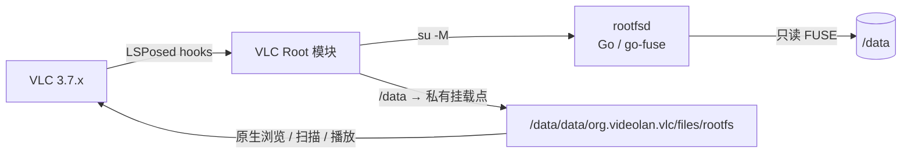

# VLC Root

**让官方 VLC for Android 直接浏览、扫描、播放 `/data` 下的文件。**

> 应用名：**VLC 数据访问**（模块包名仍是 `com.example.vlcroot`）

[](https://github.com/jiugeyo/vlcroot/actions/workflows/build-apk.yml)
[](#更新日志)
[](#兼容性)
[](#兼容性)
[](LICENSE)

> An LSPosed module that gives the official VLC for Android read-only access to `/data` through an in-process FUSE mirror. Tested on Android 16 + VLC 3.7.1.

---

## 功能

| 功能 | 状态 | 说明 |
|---|---|---|
| VLC 原生浏览器列 `/data` 目录 | ✅ | 不替换 VLC 的 UI，走它自己的文件浏览器 |
| 媒体库添加自定义路径 / 扫描 | ✅ | 路径映射到 FUSE 挂载点，由 VLC 原生扫描 |
| 直接播放 / 拖动进度 | ✅ | VLC 直接读 FUSE 文件，Range 正常 |
| `.m3u` / `.m3u8` 播放列表 | ✅ | 模块会重写路径 |
| 外挂字幕 | ✅ | 视 VLC 版本，hook 字幕加载路径 |
| HTTP 兜底播放 | ✅ | 非 FUSE 场景仍可用 `127.0.0.1` 分块读 |
| 写入 `/data` | ❌ | 只读镜像，避免误删系统数据 |
| VLC 退出后自动回收 | ✅ | `rootfsd` 监听 VLC 主进程，进程结束即退出 |
| 32 位设备 | ❌ | 目前只提供 `arm64-v8a` |

> 不需要重编译 VLC，不需要改 VLC 签名，也不需要 Magisk 模块。所有改动都在 LSPosed 模块里。

---

## 原理



1. 模块在 VLC 进程启动时，从自己的 APK 里解出 `rootfsd`（arm64 静态二进制），复制到 `/data/local/tmp/vlcrootfs/`；
2. 通过 `su -M` 在**全局 mount namespace** 启动 `rootfsd`，把 `/data` 只读镜像到 VLC 私有目录：
   ```
   /data/data/org.videolan.vlc/files/rootfs
   ```
3. hook `FileUtils.getUri()`、`File.getCanonicalPath()`、`DirectoryRepository.addCustomDirectory()` 等入口，把 `/data/...` 映射到镜像路径；
4. VLC 的原生浏览器、媒体库扫描器、播放器都只看到普通文件，实际由 FUSE 从 `/data` 读取。

为什么必须用 FUSE：VLC 的目录浏览和媒体库扫描发生在 **libVLC / libmedialibrary 的 C++ 层**，Java hook 改不到；只有让内核里出现一个“看起来普通”的目录，原生层才会正常扫描和播放。

### Android 16 兼容补丁

Android 16 / 部分小米内核会向 FUSE 守护进程发送 go-fuse 不认识的 opcode（实测 `2016`）。原版 go-fuse 只打日志、不回 reply，导致 `ls`/扫描永久卡死。

本项目在 CI 里对 vendored go-fuse 打补丁：未知 opcode 统一回 `ENOSYS`，由内核走 fallback。补丁脚本见 [`scripts/patch_go_fuse.py`](scripts/patch_go_fuse.py)。

---

## 兼容性

| 项目 | 要求 |
|---|---|
| Android | 8.0+（`minSdk 26`）；**Android 16 实测通过** |
| VLC | 3.7.x（**3.7.1 实测**） |
| CPU | arm64-v8a |
| Root | 支持 `su -M`（全局 mount namespace）的 root 管理器；**SukiSU Ultra / KernelSU 实测**，Magisk 未验证 |
| LSPosed | LSPosed 2.2.1+ / libxposed API 102 |
| 签名 | 构建产物**未签名**，安装前需自行签名 |

> VLC 升级后如果改了类名/方法名，hook 可能失效；日志里会看到 `hook failed`，需要按新版本调整。

---

## 安装

### 1. 下载

打开仓库的 **Actions → build-apk → 最新一次成功运行**，页面底部下载：

```
vlcroot-unsigned-apk.zip
```

解压得到：

```
app-release-unsigned.apk
```

### 2. 用 MT 管理器签名

未签名 APK 不能直接安装：

1. MT 管理器打开 `app-release-unsigned.apk`；
2. 菜单 → **APK 签名**；
3. 选择你的 key（例如 `JGjiuge.key`）或新建签名；
4. 勾选 **V1 + V2**，保存；
5. 安装签名后的 APK。

以后升级必须用**同一个 key** 签名，否则不能覆盖安装。

> 从旧 debug 版换到自己的签名时，需要先卸载旧模块。VLC 的数据库和自定义路径不受影响。

### 3. 启用模块

1. 安装并打开 **LSPosed**（或 Vector）；
2. 模块列表里启用 **VLC Root**；
3. 作用域只勾选 **VLC**；
4. 强制停止 VLC。

### 4. 授权 root

首次启动 VLC 时，root 管理器会弹窗：

> **给 VLC 授予 root，不是给 VLC Root 模块。**

模块本身不需要 root；它是在 VLC 进程里执行 `su` 的。

### 5. 添加路径

VLC → 左侧 **媒体库** → **添加自定义路径**，例如：

```
/data/喜鹊谋杀案
```

保存后：

- VLC 原生浏览器能看到该目录和文件；
- 媒体库会扫描并显示；
- 点开即可播放，拖动进度正常。

---

## 使用提示

- 路径必须是 **root 能读到** 的真实路径；软链接会被 `rootfsd` 拒绝，避免跳出白名单。
- 首次挂载需要几秒；如果添加路径后暂时为空，退出媒体库再进一次。
- 日志：
  ```bash
  adb logcat -s VlcRoot
  adb shell su -c 'cat /data/local/tmp/vlcrootfs.log'
  ```
- 查看挂载：
  ```bash
  adb shell su -c 'cat /proc/mounts | grep rootfs'
  ```
- 如果之前崩溃过、出现重复挂载或 `ls` 卡住，**重启手机**即可清理 D 状态的旧 `rootfsd`。

---

## 常见问题

**Q：为什么不能直接安装？**
A：CI 产出的是未签名 APK。Android 和 LSPosed 都要求已签名；用 MT 管理器签一下即可。

**Q：为什么必须 root？**
A：VLC 的目录浏览和媒体库扫描在 native 层，Java hook 改不到；只能通过 root 挂一个只读 FUSE 镜像。

**Q：为什么不用 Magisk 模块？**
A：这个项目刻意保持“纯 LSPosed + 运行时 `su -M`”，不依赖 Magisk/KernelSU 模块，升级 VLC 或换 root 管理器时影响更小。

**Q：添加自定义路径后没反应？**
A：按顺序检查：
1. 日志里是否有 `rootfs mounted at ...`；
2. `cat /proc/mounts | grep rootfs` 是否有挂载；
3. 路径是否真实存在、root 是否可读；
4. 是否残留旧挂载：重启手机后再试。

**Q：媒体库扫描不到？**
A：先确认原生浏览器能列出文件；媒体库扫描依赖 VLC 版本和索引状态，可以在 VLC 设置里清空媒体库后重新扫描。

**Q：VLC 更新后失效？**
A：LSPosed hook 依赖 VLC 内部类名/方法名。升级 VLC 后先看 `adb logcat -s VlcRoot` 的 `hook failed`，再按新版本调整 `ModuleMain.kt`。

**Q：支持 32 位 / x86 / SD 卡？**
A：目前只构建 `arm64-v8a`，只针对 `/data`；SD 卡和 32 位未适配。

---

## 构建

### GitHub Actions（推荐）

推到 `main` 会自动构建，或手动 **Actions → build-apk → Run workflow**。

构建流程：

1. Go 编译 `rootfsd`（含 go-fuse 未知 opcode 补丁）；
2. 把 `rootfsd-arm64` 放进 APK assets；
3. Gradle `assembleRelease` 产出**未签名** APK；
4. 上传 artifact `vlcroot-unsigned-apk`。

### 本地构建

需要 JDK 17、Android SDK 35、Gradle 8.9、Go 1.22：

```bash
cd rootfsd
go mod tidy
go mod vendor
python3 ../scripts/patch_go_fuse.py
CGO_ENABLED=0 GOOS=linux GOARCH=arm64 \
  go build -mod=vendor -trimpath -ldflags="-s -w" \
  -o ../app/src/main/assets/rootfsd-arm64 .

cd ..
gradle :app:assembleRelease
```

产物：

```
app/build/outputs/apk/release/app-release-unsigned.apk
```

更详细的“没有 Android Studio”流程见 [BUILD-WITHOUT-STUDIO.md](BUILD-WITHOUT-STUDIO.md)。

---

## 项目结构

```
app/src/main/java/com/example/vlcroot/
  ModuleMain.kt        LSPosed API 102 入口 + hooks
  Rootfs.kt            su -M 启动 rootfsd / 路径映射 / 版本化重挂
  RootBridge.kt        URI -> HTTP 兜底判定
  RootServer.kt        127.0.0.1 HTTP + Range + m3u 重写
  RootShell.kt         su 执行 / 分块读
  PathPolicy.kt        白名单与“是否需要 root”
  CallSite.kt          入队/播放阶段判定
  RootUris.kt          content:// 编码
  RootPathProvider.kt  壳 provider
  MainActivity.kt      模块首页（使用说明 / 打开 VLC）

rootfsd/
  main.go              Go 只读 FUSE 镜像（go-fuse v2）
  go.mod

scripts/
  patch_go_fuse.py     构建期 Android 16 opcode 补丁

.github/workflows/
  build-apk.yml        CI：rootfsd + release APK
```

设计细节见 [docs/architecture.md](docs/architecture.md)。

---

## 安全与风险

- 模块会让 **VLC 进程获得 root 执行能力**；只在你自己的设备上使用，并确认 APK 来源可信。
- `rootfsd` 是**只读**镜像，不提供写入/删除 `/data` 的能力。
- HTTP 兜底只绑定 `127.0.0.1`，不对外网开放；模块不包含遥测/联网上传。
- 发行包**未签名**，请自行签名并保管好私钥；仓库不包含任何签名私钥。
- 使用 root、LSPosed、FUSE 均有系统稳定性风险；出问题先重启，再抓日志。

---

## 更新日志

### 1.1

- `rootfsd` 监听 VLC 主进程 PID，VLC 后台被杀/强停后自动退出；
- 挂载增加 owner PID 校验，新 VLC 进程会清理旧挂载再重挂；
- 重做模块首页：移除 `/data` 路径列表/调试 UI，改为使用说明和“打开 VLC”入口；
- 应用名改为 **VLC 数据访问**，新增自适应图标；
- 版本号 1.1（versionCode 3）。

### 1.0

- 原生浏览器列 `/data`、媒体库扫描、直接播放全链路打通；
- `rootfsd` 只读 FUSE 镜像；
- 修复 Android 16 未知 FUSE opcode 导致的 `ls`/扫描卡死；
- 挂载点迁到 VLC 私有 `files/rootfs`，版本化重挂；
- release 构建改为**未签名 APK**，由用户自行签名；
- 移除调试日志，补充文档。

### 0.1

- 初版：LSPosed hook + `127.0.0.1` HTTP Range 播放 `/data` 文件。

---

## 致谢

- [VLC for Android](https://code.videolan.org/videolan/vlc-android)
- [LSPosed / libxposed](https://github.com/LSPosed/LSPosed)
- [go-fuse](https://github.com/hanwen/go-fuse)
- [NanoHTTPD](https://github.com/NanoHttpd/nanohttpd)

## 许可

[MIT](LICENSE)
